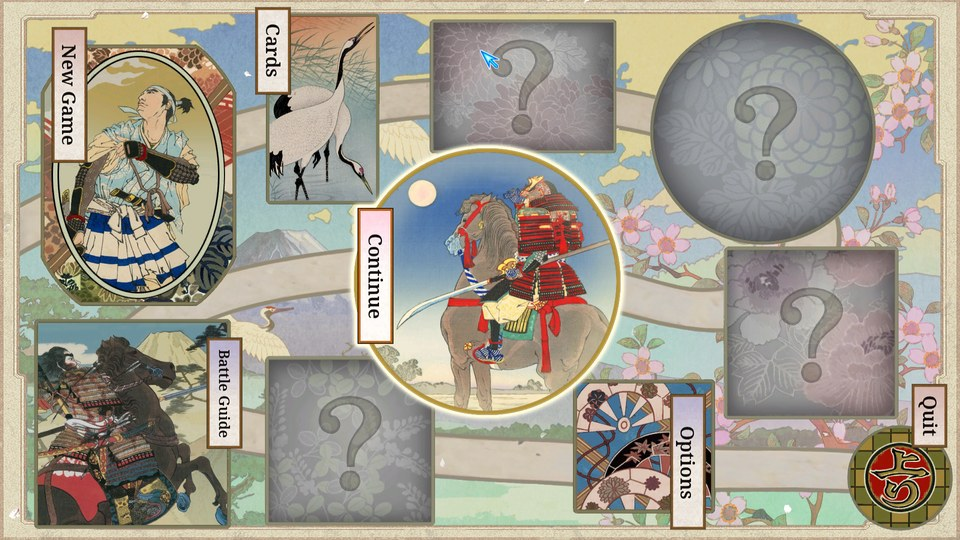
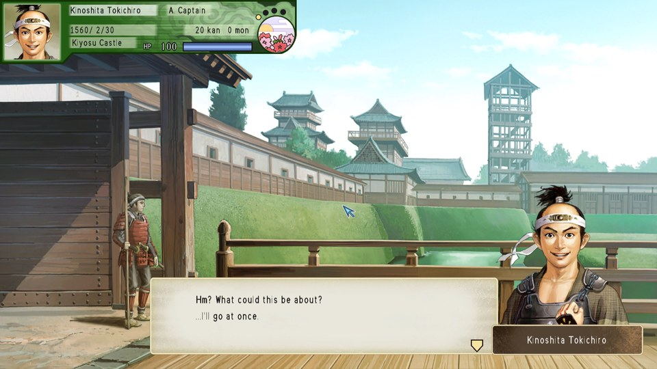
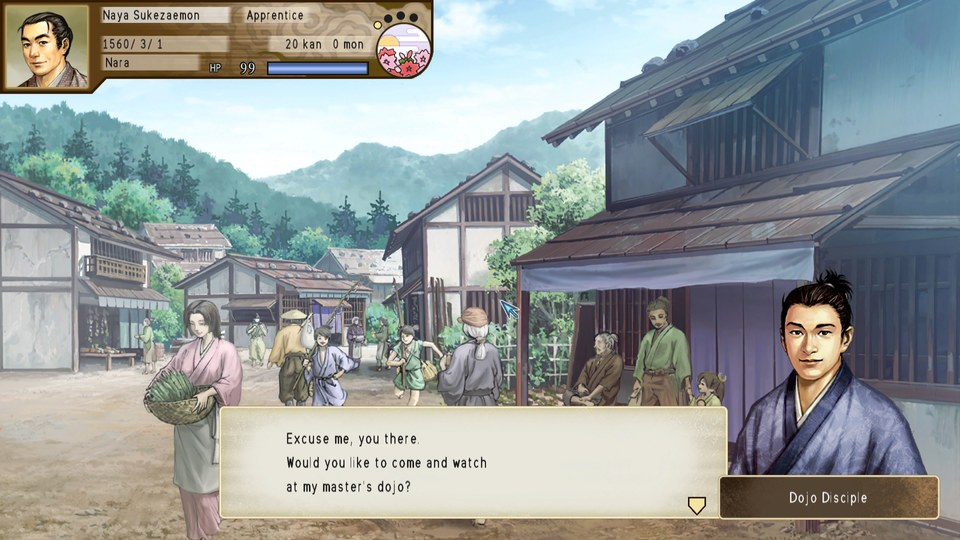
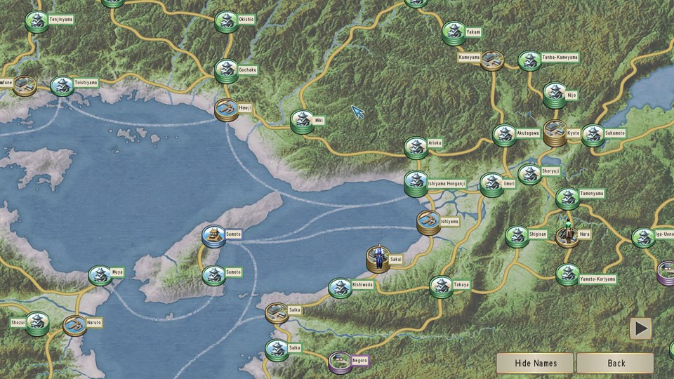
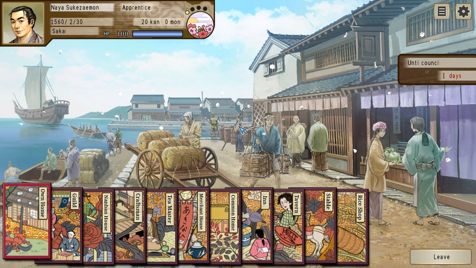
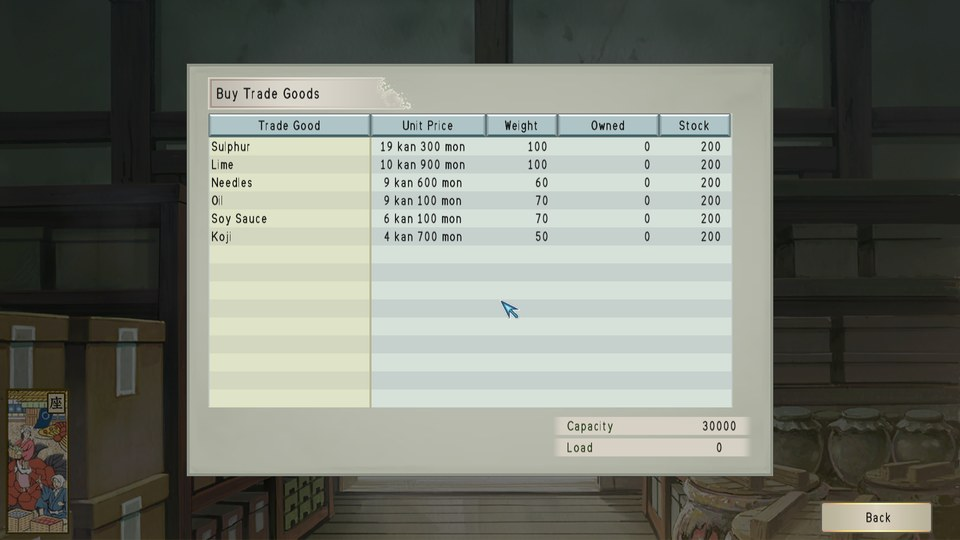
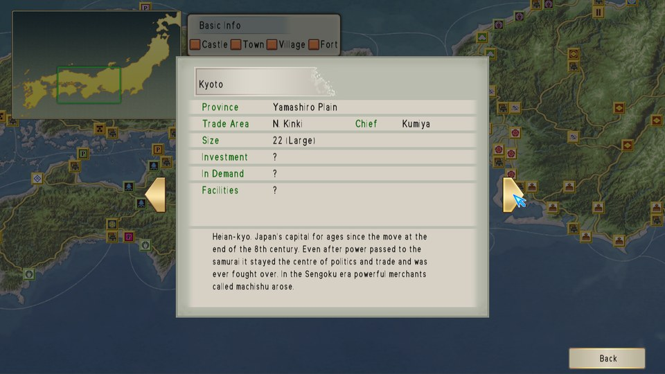
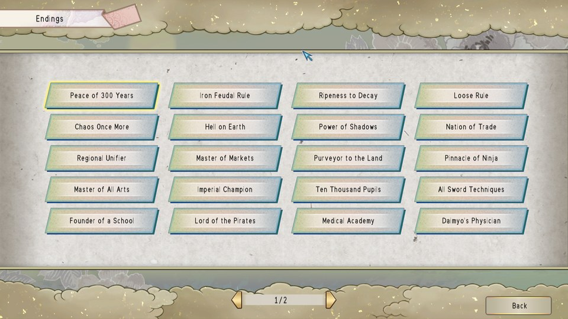
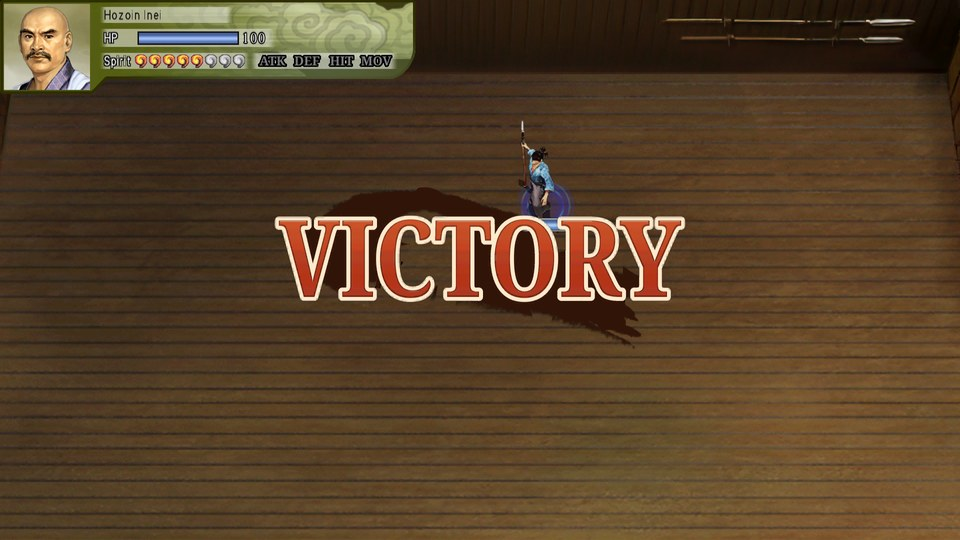

# Taiko Risshiden V DX — English Translation

A fan translation of **Taiko Risshiden V DX** (太閤立志伝V DX, Koei Tecmo, 2022) for
Windows (Steam) into English. Taiko Risshiden is Koei's Sengoku-era life simulation:
you live as a samurai, merchant, ninja, swordsman, physician or pirate and rise in the
world. DX is the HD remaster of the 2004 game, with new characters, techniques, a new
scenario and an endings list. It was released in Japanese and Chinese only.

This is a port of the [PlayStation 2 translation](https://github.com/damon-daemon/taiko-risshiden-5-english):
the text DX shares with the PS2 game reuses that English, and the text new or changed in
DX was translated for this project.

> **This is a full machine translation.** All of the game's text was translated from
> Japanese by an AI model, not by a human translator, and it has not been
> proofread by a fluent Japanese speaker. Expect occasional mistranslations, awkward
> phrasing and inconsistent terms. Corrections are welcome.

> **This is a work in progress. The first release (v0.1.0) is a pre-release for
> testing.** All of the game's text is in
> English and the main screens of the first scenario have been played through, but
> much of the game (most events, battles, the other scenarios) has not been seen yet.
> Expect text that overflows its box, odd line breaks or labels still in Japanese.

This repository contains the English text and the tools that build the English game
files. It does **not** contain the game, any of its data, or the Japanese script — you
need your own copy of the game.

## Screenshots

| | | |
|:-:|:-:|:-:|
|  |  |  |
| Title menu | Opening event | Town event |
|  |  |  |
| World map | Town and facility cards | Buying trade goods |
|  |  |  |
| Town information | Endings list | Duel |

## What's translated

- All of the game's message text (about 25,800 entries): town and job dialogue,
  commands, missions, councils, battles, the tea party, mini-games, help pages, item,
  card and town descriptions, and all biographies, including the people new in DX
- All story event scenes (about 56,700 lines of dialogue, narration and choices),
  including the events new in DX
- Menus, labels and system messages of the game program (about 2,700 strings), name
  tables (towns, castles, provinces, items, techniques, titles, ranks, missions) and
  money and number formats
- About 1,300 officer and character names, romanised with the same spelling as the PS2
  translation, plus the temporary speaker names of the event scenes
- Scenario titles and introductions, the endings list, and the kanji-reading quiz
- Graphics: title menu cards, town facility cards, card backs, map labels and markers,
  mini-game and duel labels and banners, redrawn at build time with an English font
- A proportional English font

Long names and labels are shortened where the game's boxes are too small. Where DX
changed the wording of the PS2 game (for example softer wording around deaths, or "the
overseas campaign"), the English follows DX.

## Playing it

Download the zip from [Releases](https://github.com/damon-daemon/taiko-risshiden-5-dx-english/releases)
(v0.1.0 is a pre-release: see Known issues) and follow its `README.txt`. It holds:

- an xdelta patch for each changed data file (text, event scripts, font, textures),
  applied by `apply.bat` (Windows) or `apply.sh` (Linux / Steam Deck), which first keep
  the Japanese originals in `backup_jp/` inside the game folder; `restore.bat` /
  `restore.sh` put them back;
- `dinput8.dll` and `tl_patch.bin`, copied into the game folder. The game program
  (`Taiko5DX.exe`) is not changed: `dinput8.dll` applies the English patch for the program
  in memory each time the game starts. If the game version does not match, it says so
  and the game runs in Japanese.

The patch is made for version 1.2.1 of the game. Under Proton (Linux, Steam Deck) set the
game's launch options to `WINEDLLOVERRIDES="dinput8=n,b" %command%` so that the
`dinput8.dll` of the patch is used.

Existing saves load with the English patch. A save's header (the line shown in the save
slot) is written when the game is saved, so saves made before keep a Japanese header
until they are saved again.

## Building from source

Requirements: Python 3.10+, the Noto Serif fonts (`NotoSerif-Bold.ttf`,
`NotoSerif-SemiBold.ttf`, ... in `/usr/share/fonts/noto/`), used to draw the English
into graphics, `clang`, `lld-link` and `llvm-dlltool` (LLVM) for `dinput8.dll`, and
`xdelta3` for release packages.

```
python -m venv .venv
.venv/bin/pip install -r requirements.txt
cp -r "/path/to/Taiko Risshiden V DX" game_clean   # an unmodified install, v1.2.1
.venv/bin/python tools/setup.py                    # extracts script/ from your game, applies tl/
.venv/bin/python tools/build.py                    # writes the English files to build/out/
.venv/bin/python tools/package.py 0.1.0            # release/<name>_v0.1.0.zip
```

`tools/setup.py` checks the game files' SHA-1 and generates `script/`, which pairs the
Japanese text from your game with the English from `tl/`. `game_clean/`, `script/` and
`build/` are never committed. Re-run `setup.py` after editing anything in `tl/`.
`build/out/` holds the changed data files plus `dinput8.dll` and `tl_patch.bin`;
`tools/package.py` turns the data files into xdelta patches against your game files and
adds the apply / restore scripts and a README.txt. No game data is packaged.

## Repository layout

| Path | Contents |
|---|---|
| `tl/msgNN.txt` | English for each message block of TAI5MSG_JP.DAT, by entry number (`@N`) |
| `tl/ev/<FILE>.txt`, `tl/ev/names.txt` | English for the event scripts (data/EVENT), by script and string number; event-only speaker names |
| `tl/ui.txt`, `tl/exestr.txt` | English for strings in the game program, by table index or address |
| `tl/tables/` | English for the program's name tables (towns, items, techniques, titles, ...) |
| `tl/names_persons.json` | English officer and character names |
| `tl/scenarios.txt`, `tl/endings.txt` | Scenario titles and introductions; the endings list |
| `tl/menu.txt`, `tl/towncards.txt`, `tl/uigfx.txt`, `tl/mggfx.txt` | Text drawn into graphics |
| `tools/setup.py`, `tools/build.py`, `tools/package.py` | Create `script/`; build the English game files; make the release zip |
| `tools/loader.py`, `tools/loader/loader.c` | The program patch as `tl_patch.bin` and the `dinput8.dll` that applies it in memory |
| `tools/tl.py`, `tools/evtl.py` | Validate and word-wrap translations (message text, event scripts) |
| `tools/msgfile.py`, `msgscript.py`, `evscript.py`, `text.py` | Message and event-script formats |
| `tools/exepatch.py`, `pesect.py`, `ui.py`, `exestr.py`, `tables.py`, `uihooks.py` | Program patches, the English code/data section, program strings and name tables |
| `tools/names.py` | English names in the game (name lookup hooks, speaker nameplates) |
| `tools/font.py`, `latinfont.py` | Proportional English font and text measuring |
| `tools/g1t.py`, `menugfx.py`, `towncards.py`, `uigfx.py`, `mggfx.py`, `maplabels.py` | Texture format and redrawn graphics, map labels |
| `tools/scenarios.py`, `endings.py` | Scenario titles and intros, endings list |
| `tools/dev/`, `tools/emu/` | Development helpers (disassembly, PS2 port scripts, Proton automation) |

## Known issues

- **Most of the game has not been play-tested yet**: story events, battles and sieges,
  and scenarios other than the first. Reports with a screenshot are welcome.
- Many message boxes keep the Japanese line breaks, so a long English line sometimes
  leaves a short last line on a page of its own.
- Plurals with a count of 1 read "1 days", "1 nights".
- The title art, the screenshots inside the mini-game previews, and some Chinese
  hand names in Oicho-Kabu stay as they are.
- Name entry still takes Japanese kana.

- The patch for the program (`dinput8.dll`) has not been tested with the Steam release
  yet; testers with the Steam version are welcome.

Tested with Proton on Linux only. Bug reports with a screenshot and where it happened
are welcome.

## Credits

- Translation and hacking: [damon-daemon](https://github.com/damon-daemon)
- Taiko Risshiden V DX © Koei Tecmo. This is an unofficial fan project, not affiliated
  with or endorsed by Koei Tecmo. Please support the official releases.

## License

The tools, fonts, documentation and English translation text in this repository
are released under the [MIT License](LICENSE). This covers only original work in
this repository: the game itself and all of its content (code, Japanese text,
graphics, audio) are copyright Koei Tecmo and are not included or licensed here.
